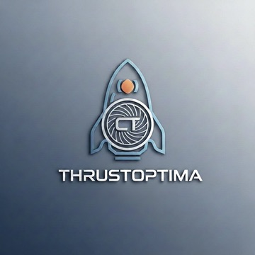

[forks-shield]: https://img.shields.io/github/forks/ItsMavey/ThrustOptima.svg?style=for-the-badge

[forks-url]: https://github.com/ItsMavey/ThrustOptima/network/members

[stars-shield]: https://img.shields.io/github/stars/ItsMavey/ThrustOptima.svg?style=for-the-badge

[stars-url]: https://github.com/ItsMavey/ThrustOptima/stargazers

[issues-shield]: https://img.shields.io/github/issues/ItsMavey/ThrustOptima.svg?style=for-the-badge

[issues-url]: https://github.com/ItsMavey/ThrustOptima/issues

[license-shield]: https://img.shields.io/badge/License-Proprietary-red.svg?style=for-the-badge

[license-url]: LICENSE.md


<!-- PROJECT LOGO -->
<div align="center">

[![Forks][forks-shield]][forks-url]
[![Stargazers][stars-shield]][stars-url]
[![Issues][issues-shield]][issues-url]
[![Personal][license-shield]][license-url]

  <a href="https://github.com/ItsMavey/ThrustOptima">
    
  </a>

<h3 align="center">ThrustOptima</h3>

  <p align="center">
    A CT Scan Analyzer for Rocket Engines
    <br />
    For Space Concordia - Rocketry Division
    <br />
    <br />
    <a href="https://github.com/ItsMavey/ThrustOptima"><strong>Explore the docs »</strong></a>
    <br />
    <a href="https://github.com/ItsMavey/ThrustOptima/issues/new?labels=bug&template=bug-report---.md">Report Bug</a>
    &middot;
    <a href="https://github.com/ItsMavey/ThrustOptima/issues/new?labels=enhancement&template=feature-request---.md">Request Feature</a>
    <br />
    <br />
    </p>

[](mailto:contact@itsmavey.com)
[](https://github.com/ItsMavey)

***
</div>


<!-- TABLE OF CONTENTS -->
<details>
  <summary>Table of Contents</summary>
  <ol>
    <li><a href="#about-the-project">About The Project</a></li>
    <li><a href="#limitations-and-constraints">Limitations and Constraints</a></li>
    <li><a href="#features">Features</a></li>
    <li><a href="#tech-stack">Tech Stack</a></li>
    <li><a href="#installation">Installation</a></li>
    <li><a href="#usage">Usage</a></li>
    <li><a href="#theory">Theory</a>
        <ol>
            <li><a href="#ct-scans">CT Scans</a></li>
            <li><a href="#image-processing">Image Processing</a></li>
            <li><a href="#data-analysis">Data Analysis</a></li>
        </ol>
    </li>
    <li><a href="#contributors">Contributors</a></li>
    <li><a href="#contributing">Contributing</a></li>
    <li><a href="#license">License</a></li>
    <li><a href="#contact">Contact</a></li>
    <li><a href="#acknowledgements">Acknowledgements</a></li>
  </ol>
</details>

***

## About The Project

ThrustOptima is a specialized software tool designed to analyze CT scans of rocket engines. It is developed to assist
Space Concordia - Rocketry Division in evaluating the structural integrity of Additive Manufacturing (AM) in a
Non-Destructive Evaluation (NDE) context. By processing CT scan data, ThrustOptima identifies potential defects and
anomalies within the engine components, ensuring they meet safety and performance standards before deployment.

As resources are limited in the context of a student-run rocketry division, ThrustOptima is optimized for efficiency and
ease of use, allowing team members to quickly assess the quality of their AM rocket engines without extensive training
in image processing or data analysis.

The NDE capabilities of ThrustOptima are an important aspect of Space Concordia's commitment to safety and innovation in
rocketry. By leveraging advanced imaging techniques, the software helps the team maintain high standards in their
engineering practices while reducing the costs associated with traditional destructive testing methods.

***

## Tech Stack

Currently in development, the planned tech stack includes:

#### Language

[](https://www.python.org/)

#### Libraries

[](https://numpy.org/)
[](https://scipy.org/)
[](https://opencv.org/)
[](https://matplotlib.org/)
[](https://pydicom.github.io/)

***

## Installation

To install ThrustOptima, follow these steps:

1. Clone the repository:
   ```bash
   git clone https://github.com/itsmavey/ThrustOptima
   ```

2. Navigate to the project directory:
   ```bash
   cd ThrustOptima
   ```

3. Install the required dependencies:
   ```bash
   pip install -r requirements.txt
   ```

***

## Usage

To use ThrustOptima, follow these steps:

1. Navigate to the project directory:
   ```bash
   cd ThrustOptima
   ```

2. Run the main application:
   ```bash
    python main.py [-t] <path> [start] [finish]
    ```

    - `-t`: Optional flag to enable trace mode for detailed logging.
    - `<path>`: Required argument specifying the path to the directory containing the CT scan DICOM files.
    - `[start]`: Optional argument specifying the starting index of the CT scan slices to process
    - `[finish]`: Optional argument specifying the ending index of the CT scan slices to process.

***

## Contributing

To contribute to this project, you need to be part of Space Concordia - Rocketry Division or request authorization from
the organization.

For a member of Space Concordia - Rocketry Division, communicate with your lead before processing to any changes.

***

## License

This project is licensed under the Proprietary License Agreement - see the [LICENSE](LICENSE.md) file for details.

***

## Contact

ItsMavey - [GitHub](https://github.com/ItsMavey) - [Email](mailto:contact@itsmavey.com)

***

## Acknowledgements

README template inspired by [othneildrew/Best-README-Template](https://github.com/othneildrew/Best-README-Template)
